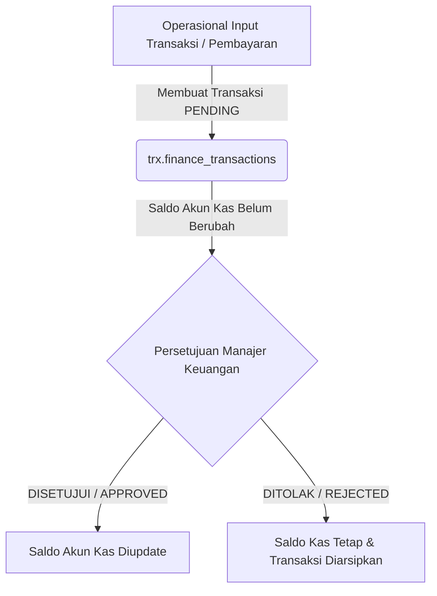

# Dokumentasi Sistem Modul Keuangan & Penyelarasan Database (Finance Command Center)

Dokumen ini menyediakan panduan arsitektur, detail alur kerja, mekanisme penghapusan data (cascading deletes), pemetaan variabel laporan keuangan, serta langkah-langkah troubleshooting sinkronisasi database untuk Modul Keuangan di Sistem Manajemen Belanja Giling Gabah.

---

## 1. Arsitektur Modul Keuangan & Ledger

Modul Keuangan menggunakan sistem pencatatan transaksi kas harian (*General Ledger*) yang melacak arus kas masuk (*Inflow*) dan arus kas keluar (*Outflow*). Modul ini bekerja di atas skema database `trx` dan `sys` pada PostgreSQL.

### A. Tabel Utama Keuangan
1.  **`trx.finance_accounts`**:
    Menyimpan akun kas/bank (contoh: *Kas Pabrik*, *Modal Pemilik*) beserta saldo saat ini (`balance`).
2.  **`trx.finance_transactions`**:
    Menyimpan riwayat mutasi keuangan baik arus masuk maupun keluar. Memiliki kolom `status` yang mengontrol apakah transaksi tersebut sudah memengaruhi saldo akun kas atau belum.
3.  **`trx.purchase_payments`**:
    Pencatatan pelunasan utang belanja gabah ke petani.
4.  **`trx.sale_payments`**:
    Pencatatan penerimaan pembayaran dari pembeli atas nota penjualan beras/limbah.

### B. Chart of Accounts (CoA) & Aliran Kas
Setiap transaksi dikelompokkan ke dalam kategori akuntansi tertentu melalui pemetaan kategori di backend (`src/utils/accounting.map.js`):
*   **Arus Kas Masuk (IN)**:
    *   `SALES`: Pendapatan dari Penjualan Produk (Beras, Dedak, Sekam).
    *   `CAPITAL_IN`: Penambahan modal dari pemilik.
*   **Arus Kas Keluar (OUT)**:
    *   `PURCHASE_PAYMENT`: Pembayaran pembelian gabah (mengurangi utang/AP).
    *   `PROCESS_COST`: Biaya operasional giling ekstra (solar, buruh giling, benang).
    *   `DRYING_COST`: Biaya penjemuran gabah ekstra (buruh jemur, sewa lantai).
    *   `OVERHEAD`: Biaya umum operasional pabrik (listrik, pemeliharaan, gaji bulanan).

---

## 2. Alur Verifikasi Dua Tahap (Two-Step Approval)

Untuk mencegah kebocoran kas, transaksi pengeluaran operasional dan penerimaan pembayaran tidak langsung memotong/menambah saldo kas secara otomatis. Alur kerja verifikasi adalah sebagai berikut:



1.  **Status PENDING**:
    Saat pembayaran penjualan dibuat atau biaya operasional giling dimasukkan, transaksi dicatat ke `trx.finance_transactions` dengan `status = 'PENDING'`. Pada tahap ini, saldo akun kas (`trx.finance_accounts.balance`) **tidak berubah**.
2.  **Status APPROVED**:
    Manajer Keuangan meninjau transaksi tertunda di *Approval Center*. Ketika disetujui, status transaksi diubah menjadi `'APPROVED'` dan barulah saldo akun kas yang bersangkutan diperbarui (ditambah untuk `IN` atau dikurangi untuk `OUT`).
3.  **Status REJECTED**:
    Jika ditolak, status diubah menjadi `'REJECTED'` dengan alasan penolakan dan tidak memengaruhi saldo akun kas apa pun.

---

## 3. Mekanisme Penghapusan Transaksi Kas (Cascading Reversals)

Ketika transaksi operasional dihapus dari sistem, riwayat transaksi keuangan pendukung yang berasosiasi dengan data tersebut harus dibersihkan secara aman untuk menjaga keseimbangan neraca keuangan (*Balance Sheet*).

### A. Biaya Giling (Process Cost)
*   **File**: `src/services/process.service.js` (Fungsi: `deleteProcessCost`)
*   **Logika**:
    Saat biaya ekstra giling dihapus, sistem memeriksa kolom `finance_transaction_id` pada biaya yang dihapus. Jika ada transaksi keuangan terkait:
    1.  Jika transaksi tersebut berstatus `'APPROVED'`, saldo akun kas dikembalikan dengan menambahkan kembali jumlah uang yang keluar (`balance = balance + amount`).
    2.  Catatan transaksi keuangan di `trx.finance_transactions` dihapus secara permanen.
    3.  Harga Pokok Penjualan (HPP) beras hasil gilingan direkalkulasi secara otomatis tanpa memperhitungkan biaya yang dihapus tersebut.

### B. Biaya Jemur (Drying Cost)
*   **File**: `src/services/drying.service.js` (Fungsi: `deleteDryingCost`)
*   **Logika**:
    Sama halnya dengan biaya giling, penghapusan biaya jemur akan memeriksa status transaksi kas terkait. Saldo akun kas hanya akan dikembalikan (ditambahkan kembali) jika status transaksi tersebut adalah `'APPROVED'`. Setelah itu, transaksi keuangan di `trx.finance_transactions` dihapus.

### C. Pembayaran Penjualan (Sale Payment)
*   **File**: `src/services/salesV2.service.js` (Fungsi: `PaymentService.delete`)
*   **Logika**:
    Saat mencatatkan pembayaran penjualan baru, sistem mendaftarkan `payment.id` yang unik ke dalam `reference_id` di ledger transaksi kas (menggunakan `source_module = 'SALES'`). Saat pembayaran dihapus:
    1.  Proses dijalankan dalam **Database Transaction** (`BEGIN ... COMMIT`) agar menjamin konsistensi.
    2.  Sistem mencari transaksi kas dengan `reference_id = paymentId` dan `source_module = 'SALES'`.
    3.  Jika berstatus `'APPROVED'`, saldo akun kas dikurangi (`balance = balance - amount`) karena uang masuk dibatalkan.
    4.  Catatan pembayaran di `trx.sale_payments` dan transaksi kas di `trx.finance_transactions` dihapus dari database.

---

## 4. Pemetaan Variabel Laporan Laba Rugi & PDF

Ada penyesuaian penamaan variabel keuangan di backend yang sempat memicu nilai laporan keuangan tercetak sebagai `Rp0` atau `0.0%` pada ekspor PDF.

### Variabel Utama Keuangan
*   **Pendapatan Kotor / Revenue**: Diambil dari nilai penjualan produk yang disetujui.
*   **HPP / COGS**: Beban pokok penjualan gabah dan biaya proses produksi beras.
*   **Laba Kotor (Gross Profit)**: `Revenue - COGS`.
*   **OPEX (Operating Expenses)**: Total pengeluaran operasional (Overhead + Biaya Giling + Biaya Jemur).
*   **Laba Bersih (Net Profit / Operating Profit)**: `Gross Profit - OPEX`.

### Keselarasan Kode dengan PDF Pembuat (`src/services/pdf.service.js`)
Layanan pembuat dokumen PDF (`generateFinancialReport`) telah diselaraskan untuk memetakan struktur data yang dikembalikan oleh `finance.service.js`:
*   Menggunakan `summary.operatingProfit` untuk mencetak baris **LABA BERSIH (Net Profit)**.
*   Menggunakan `summary.operatingMarginPct` untuk mencetak rasio **Net Margin**.

---

## 5. Sinkronisasi Skema Database & Troubleshooting Migrasi

Jika Anda menemukan error internal server seperti `column "status" does not exist` atau `column b.jenis_gabah does not exist` pada lingkungan staging/produksi, hal tersebut dikarenakan runner migrasi PostgreSQL mendeteksi ketidakcocokan histori.

### A. Penyebab Utama Masalah
Runner migrasi (`npm run migrate` yang memanggil `scripts/migrate.js`) membandingkan file-file di folder `migrations/` dengan tabel riwayat `public.migrations_history`.
Jika database diinisialisasi secara manual atau dipulihkan melalui schema dump, tabel fisik mungkin sudah ada di database, tetapi tidak terdaftar di `migrations_history`. Akibatnya, runner migrasi mencoba mengeksekusi migrasi lama (seperti `002_create_batches.sql`) dari awal, lalu gagal karena mencoba membuat indeks pada VIEW kompatibilitas yang sudah terbentuk. Kegagalan ini menghentikan proses migrasi sehingga migrasi-migrasi baru (seperti migrasi keuangan `067` dan kolom `jenis_gabah` `042`) tidak pernah berjalan.

### B. Solusi Langkah Penyelarasan (Troubleshooting Runbook)
Untuk menyelaraskan database di server atau lokal baru:

1.  **Daftarkan Migrasi Lama ke Histori (Tanpa Eksekusi Ulang)**:
    Jalankan perintah SQL berikut untuk menandai semua migrasi lama (sebelum migrasi nomor `062`) sebagai "selesai" di tabel histori, sehingga runner migrasi akan melewatinya secara otomatis:
    ```sql
    TRUNCATE TABLE public.migrations_history RESTART IDENTITY;
    
    INSERT INTO public.migrations_history (filename) VALUES 
    ('001_create_users.sql'),
    ('002_create_batches.sql'),
    ('003_create_purchases.sql'),
    ('004_create_processes.sql'),
    ('005_create_process_batches.sql'),
    ('006_create_sales_tables.sql'),
    ('007_create_files.sql'),
    ('008_create_wizard_states.sql'),
    ('009_create_upload_intents.sql'),
    ('010_create_log_history.sql'),
    ('011_add_purchases_filled_by.sql'),
    ('012_create_batch_links.sql'),
    ('013_create_purchase_photos.sql'),
    ('014_create_batch_completions.sql'),
    ('015_add_admin_notes.sql'),
    ('016_add_batch_is_active.sql'),
    ('017_add_kondisi_gabah.sql'),
    ('018_create_drying_processes.sql'),
    ('019_create_drying_batches.sql'),
    ('020_create_drying_sessions.sql'),
    ('021_create_drying_photos.sql'),
    ('022_create_drying_links.sql'),
    ('023_add_drying_name.sql'),
    ('024_drying_improvements.sql'),
    ('025_add_drying_type.sql'),
    ('026_add_submission_tracking.sql'),
    ('027_fix_submission_entity_id.sql'),
    ('028_add_pending_approval_status.sql'),
    ('029_create_inventory.sql'),
    ('030_create_pendataan_gabah.sql'),
    ('031_migrate_pendataan_fields.sql'),
    ('032_add_drying_people_involved.sql'),
    ('033_add_quality_fields_to_pendataan.sql'),
    ('034_enterprise_schemas_and_item_categories.sql'),
    ('035_move_log_history_to_log_schema.sql'),
    ('036_move_inventory_to_trx_schema.sql'),
    ('037_move_drying_to_trx_schema.sql'),
    ('038_move_sys_tables.sql'),
    ('039_move_batch_purchase_to_trx.sql'),
    ('040_move_processes_sales_to_trx.sql'),
    ('041_add_process_to_inventory.sql'),
    ('042_add_jenis_gabah_to_batches.sql'),  -- Hanya jika kolom jenis_gabah sudah ada, jika belum biarkan kosong agar dieksekusi ulang
    ('042_fix_batches_update_trigger.sql'),
    ('043_enhance_milling_process.sql'),
    ('044_create_customer_tiers.sql'),
    ('045_create_customers.sql'),
    ('046_create_price_list.sql'),
    ('047_create_sales_v2.sql'),
    ('048_create_sale_items.sql'),
    ('049_create_sale_deliveries.sql'),
    ('050_create_sale_payments.sql'),
    ('051_create_sale_returns.sql'),
    ('052_sales_auto_numbering.sql'),
    ('053_sales_status_triggers.sql'),
    ('054_move_sales_v2_to_trx.sql'),
    ('055_fix_sales_v2_triggers.sql'),
    ('056_fix_inventory_column_in_triggers.sql'),
    ('057_fix_inventory_transaction_column.sql'),
    ('058_finance_module.sql'),
    ('059_production_costs_and_waste.sql'),
    ('060_update_inventory_transaction_types.sql'),
    ('061_create_milling_sessions.sql');
    ```

2.  **Jalankan Perintah Migrasi**:
    Setelah histori diselaraskan, jalankan perintah migrasi backend untuk menerapkan file migrasi yang benar-benar tertunda (`062` sampai `069`):
    ```bash
    npm run migrate
    ```
    Perintah ini akan secara otomatis menambahkan kolom `status` pada tabel keuangan dan menerapkan pembaruan skema penting lainnya secara aman.
